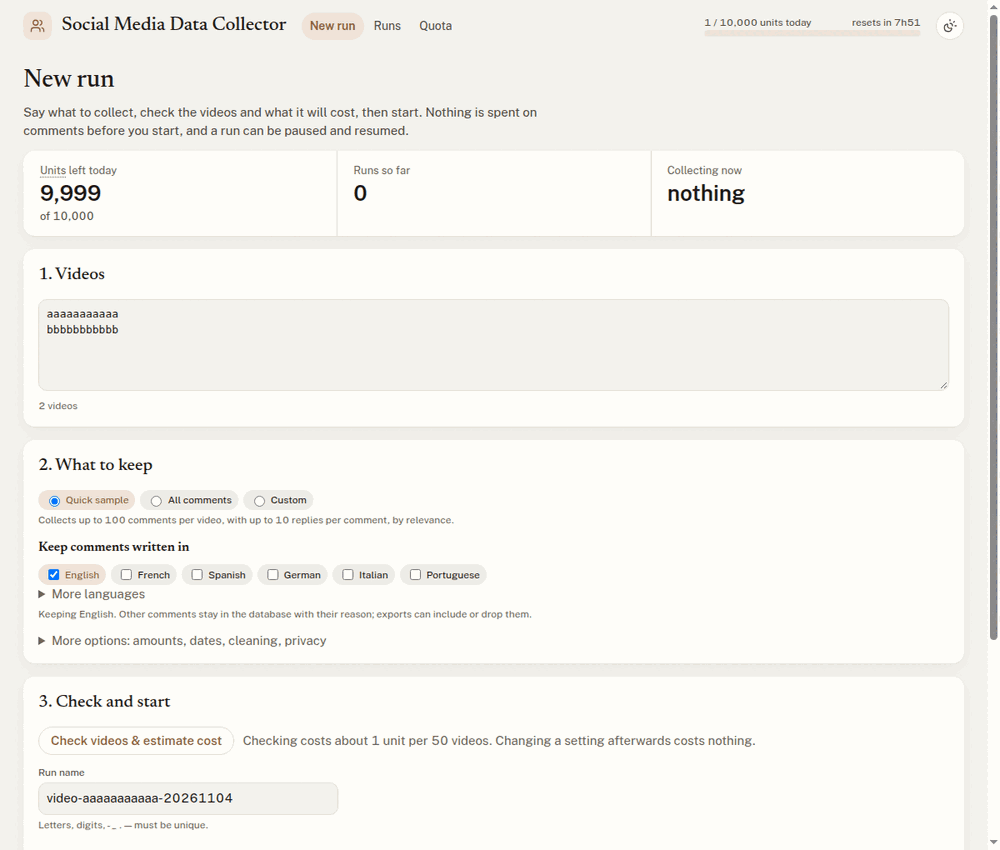
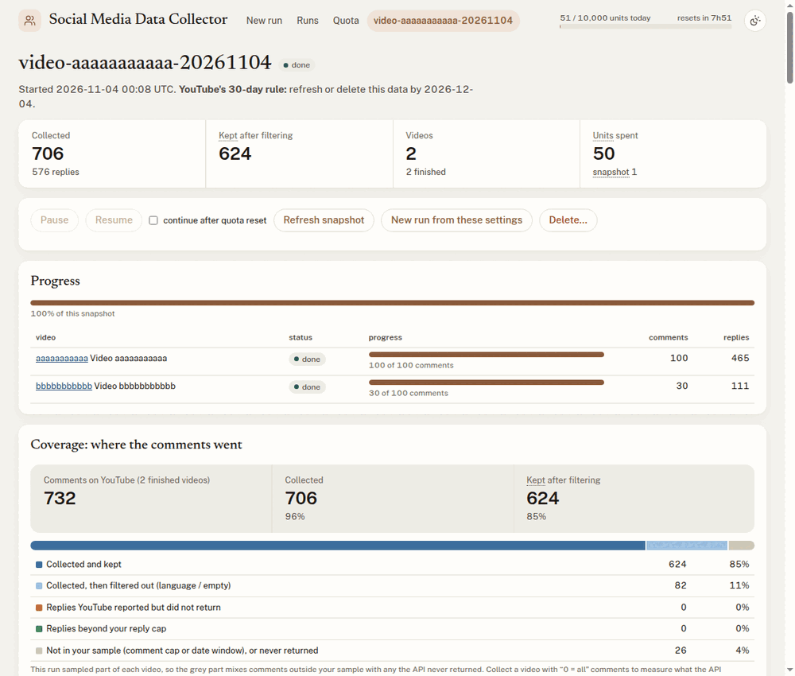

# Social Media Data Collector (`smdc`)

[](https://github.com/Kevin-Campos-Moinier/YouTube-Data-Collector/actions/workflows/tests.yml)

Collect social media comments for research through the platforms' official APIs. Collections
are reproducible, stay within the quota, can be resumed, and pseudonymize commenters by default.
YouTube is supported today. The code is organised so other platforms (Reddit…) can be added as
new *sources* without touching the rest.

Version 2 is a complete rewrite of the YouTube Data Collector (version 1). What changed and
why is in [docs/changes-from-v1.md](docs/changes-from-v1.md) and [CHANGELOG.md](CHANGELOG.md);
see also [History](#history). For now, version 2 lives on this repository's `v2` branch, and the `main` branch keeps
version 1 as it was published ([`v1.0.0`](https://github.com/Kevin-Campos-Moinier/YouTube-Data-Collector/tree/v1.0.0)).

- **Nothing is lost:** every page is saved as it arrives. A run that hits the daily quota pauses,
  and `resume` continues the next day (or `--wait` does it automatically).
- **Quota-efficient:** replies come with the comments whenever possible, videos are checked
  before collection, and the cost is estimated before you start.
- **Reproducible:** a run is a TOML file frozen into the database, and exports ship a manifest,
  an exclusion report and a codebook.
- **Non-destructive processing:** the raw text is kept, and cleaned text, detected language and
  exclusion reason are added as columns. Processing can be redone at no quota cost.
- **Pseudonymous by default:** commenters become keyed hashes and `@handles` are masked.
- **Snapshots:** re-collect the same videos later to follow likes over time and detect comments
  that were deleted or hidden.
- **Dashboard:** a local web page to plan, launch, watch, explore and export runs.

## Install and launch

You need Python 3.11 or newer and this folder. After that, starting the dashboard is a double-click: the first launch
installs everything else by itself, then the dashboard asks for a YouTube API key and shows how to get one. Python
itself has to be installed first: the launchers only look for it, and say where to get it if it is missing.

**Get this folder.** On the [Releases page](https://github.com/Kevin-Campos-Moinier/YouTube-Data-Collector/releases),
download the *Source code (zip)* of the latest version 2 release (2.x, marked *Pre-release*) and unzip it anywhere. With
git: `git clone --branch v2 https://github.com/Kevin-Campos-Moinier/YouTube-Data-Collector.git` (without
`--branch v2`, you get version 1).

### 1. Install Python (once per computer)

**Windows.** Download the installer from <https://www.python.org/downloads/>. On its first
screen, tick **"Add python.exe to PATH"**, then *Install Now*.

**macOS.** Download the macOS installer from <https://www.python.org/downloads/> and run it.
The `python3` that comes with Apple's developer tools is too old (3.9). With Homebrew,
`brew install python@3.12` works too.

**Linux.** Recent distributions ship a recent enough Python (Ubuntu 24.04: 3.12). Check with
`python3 --version`. On Debian/Ubuntu, also install the environment module:
`sudo apt install python3-venv`.

### 2. Launch the dashboard

| System | What to do |
|---|---|
| Windows | double-click **`dashboard.bat`** |
| macOS | double-click **`dashboard.command`** (the first time: right-click → *Open*, then confirm, since macOS blocks unsigned scripts) |
| Linux | run **`./dashboard.sh`** in a terminal from this folder |

The first launch creates a Python environment and installs the dependencies (a few minutes), then opens the dashboard
in your browser at <http://127.0.0.1:8777>. Without a key, its first page says how to get one, for free, from Google
(about five minutes, once per person: each person uses their own). Paste it there: it is tested (1 unit) and saved. Keep the terminal window open while you use it; closing it (or Ctrl-C) stops the dashboard and
pauses any running collection, which *Resume* continues later.

The key is saved in a `.env` in your user configuration folder, outside this folder (see the table below), so it never
travels with the code, even when the folder is synced or shared. You can also edit that file by hand, or use
`YOUTUBE_API_KEY`. A `.env` left in this folder by an older version still works, but the configuration folder is safer.
It is readable by its owner only, and never committed to git.

**Where things go.** Both locations are outside the code folder on purpose. An environment
breaks when its folder is synced or moved. A database that two computers write to through a
synced folder (OneDrive, Dropbox, iCloud) gets corrupted. Each computer therefore keeps its own:

| What | Default | Change it with |
|---|---|---|
| Python environment | `~/.venvs/smdc` (Windows: `C:\Users\<you>\.venvs\smdc`) | `SMDC_VENV` |
| Runs, database, exports | `~/smdc-data` (Windows: `C:\Users\<you>\smdc-data`) | `SMDC_DATA`, or `--data` |
| API key and secret (`.env`) | `~/.config/smdc/.env` (Windows: `%APPDATA%\smdc\.env`) | `SMDC_ENV` |

Each data folder holds its own pseudonymization secret (`.secret`), so the same commenter gets
different author keys on different computers. To get identical keys everywhere, put the same
`SMDC_SECRET=<long random string>` in `.env` on every computer **before** the first
collection.

**If something goes wrong.**
- "permission denied" on macOS/Linux: `chmod +x dashboard.command dashboard.sh`.
- "Python 3.11 or newer is required": install Python as in step 1. On Windows, reinstall with
  *Add python.exe to PATH* ticked.
- To reinstall from scratch, delete the environment folder above and launch again.

### Manual install (for command-line use)

The launcher is a convenience. By hand, from this folder:

```bash
# macOS / Linux
python3 -m venv ~/.venvs/smdc
~/.venvs/smdc/bin/pip install -e ".[all]"
~/.venvs/smdc/bin/smdc dashboard
```

```powershell
# Windows (PowerShell)
py -m venv $HOME\.venvs\smdc
& $HOME\.venvs\smdc\Scripts\pip.exe install -e ".[all]"
& $HOME\.venvs\smdc\Scripts\smdc.exe dashboard
```

`[all]` adds language detection and Parquet export. Without the dashboard, `smdc init` says how to get an API key,
then tests and saves it. Activate the environment
(`source ~/.venvs/smdc/bin/activate`, or `$HOME\.venvs\smdc\Scripts\Activate.ps1`)
to type plain `smdc …` afterwards.

## Use it: the dashboard

Start it with the launcher (above) or `smdc dashboard`. It only listens on your own
computer (127.0.0.1).



1. **New run**: paste video URLs (or `channel:@name`, `playlist:…`): the box says what it understood and which line is
   wrong. Choose *Quick sample* or *All comments* and the languages to keep; the rest is under *More options*. Your
   draft survives a reload, and *New run from these settings* starts from an earlier run.
2. **Check videos & estimate cost**: shows each video's title, channel, views and comment count, flags disabled
   or missing ones, and estimates the quota cost against what is left today. The column titles sort the list. *CSV*
   downloads it with each video's date, length and likes and the line that found it with its rank there, to choose
   videos before collecting anything. Changing a setting afterwards updates the cost without spending anything. A `search:` line has its own
   options: order, language, country, dates and length.
3. **Start collection**: shows overall and per-video progress, the time left, the quota gauge, the filtering report and
   the log. *Pause* and *Resume* work at any time. If the quota runs out, the page says when it comes back; *Continue
   automatically after the reset* takes it from there, as long as the terminal window stays open.



4. **Coverage** on the run page: how many of the video's comments on YouTube were collected,
   and where the others went (outside your sample, over your reply cap, reported by YouTube but
   never returned by its API, or filtered out by language). Collect a video with "0 = all"
   comments to measure what the API itself withholds.
5. **Explore**: comments per day for each video, languages, most liked comments, and a searchable
   table, page by page, by date or likes.
6. **Refresh snapshot** (later): collects the same videos again and lists what changed (likes,
   comments no longer public).
7. **Export**: CSV (tick *Excel* for French Excel), JSONL or Parquet, written to `exports/` in the data folder. Preview
   what it holds, then download the .zip or copy its path from the list of the run's exports.
8. **Delete**: a run, or the older snapshots a refresh leaves behind. YouTube asks that data be refreshed or deleted
   after 30 days: *Runs* shows each run's date.

The **Quota** page (or a click on the header gauge) shows today's units left, what they were
spent on (by type of call and by run), and the last 14 days.

The dashboard writes each run's settings to `runs/<name>.toml` in the data folder, so a dashboard run can be
repeated from the command line.

## Use it: the command line

```bash
smdc init                       # save your API key, after testing it (1 unit)
smdc doctor [--online]          # check this computer's setup
cp config.example.toml my-run.toml       # edit it: every option is commented
smdc estimate my-run.toml       # check videos and cost (≈1 unit per 50 videos)
smdc run my-run.toml            # collect; add --wait to span several days
smdc status [NAME]              # runs, per-video progress, filtering report, coverage
smdc resume NAME [--wait]       # continue a paused or incomplete run
smdc refresh NAME [--wait]      # new snapshot of the same videos
smdc process NAME --config other.toml   # redo text processing with other [process] settings
smdc export NAME [--format csv|jsonl|parquet] [--kept] [--excel] [--snapshot N]
smdc delete NAME [--older-snapshots] [--keep-exports] [--yes]   # for good: the data leaves the database file
```

Everything lives in the data folder (`~/smdc-data` unless `SMDC_DATA` or
`--data DIR` says otherwise): the database `smdc.sqlite`, the pseudonymization secret
`.secret`, run files and exports.

## Concepts

| Term | Meaning |
|---|---|
| **run** | One study's collection settings (name, targets, parameters), frozen at creation |
| **snapshot** | One execution of a run: the first collection, then one per `refresh` |
| **unit** | YouTube's allowance: a key has 10,000 per day by default; see [Quota](#quota) |
| **kept** | A comment that passed the language filter; the others stay in the database, with an `excluded_reason` |
| **container** | What comments hang under: a YouTube video (a Reddit post, later) |
| **item** | One comment (`depth` 0) or reply (`depth` 1), with `thread_id` and `parent_id` |
| **sample** | The comments the settings asked for: the first N threads in the chosen order and up to M replies each. Language filtering does **not** change the sample: it labels comments inside it |
| **excluded_reason** | Why a comment would be dropped by `--kept`: `empty_after_cleaning`, `other_language`, `undetected` |
| **author_key** | Pseudonymous, stable ID of a commenter (HMAC-SHA256 of the channel ID with the project secret) |

## Quota

A standard key has 10,000 units per day, reset at midnight Pacific time (09:00 in Paris). Costs:

| Call | Units | Used for |
|---|---|---|
| `videos.list` | 1 per 50 videos | titles, counts, views, length, availability check |
| `commentThreads.list` | 1 per 100 comments | comments, plus up to 5 replies each for free |
| `comments.list` | 1 per 100 replies | only for threads with more than 5 replies, up to your cap |
| `channels.list`, `playlistItems.list` | 1, then 1 per 50 videos | `channel:` and `playlist:` targets |
| `search.list` | none, but **100 calls a day** at most, 50 results each | `search:` targets (off by default) |

"Oldest first" has to read every page of a video, so it costs as much as collecting all its comments.

The tool counts its own calls. If the same key is used elsewhere, YouTube's "quota exceeded"
error is the final word and the run simply pauses. For more quota, apply to the
[YouTube Researcher Program](https://research.youtube/). Do **not** create extra projects or keys
to get around the limit: the YouTube API Terms forbid it.

## Outputs

`smdc export NAME` writes `exports/NAME/` in the data folder (or `NAME-s2/` for snapshot 2):

| File | Contents |
|---|---|
| `items.csv` | one row per comment/reply in the sample (see `codebook.md`) |
| `containers.csv` | one row per video: metadata at collection time, status, counts |
| `gone.csv` | (snapshots ≥ 2) comments sampled before and no longer public |
| `exclusion_report.json` | collected / kept / excluded by reason, for comments and replies; `coverage`: platform count vs collected, per cause and per video |
| `run_manifest.json` | exact settings, tool version, times, quota spent, per-video status |
| `codebook.md` | the meaning of every column |

## Ethics and legal notes

- **Pseudonymization is not anonymization.** Comment text can identify people (quotes are
  searchable). Store data on institutional storage, and quote paraphrased text in publications.
- **The secret** (`.secret` in the data folder, or `SMDC_SECRET`) links author keys back to accounts
  for whoever also has the raw API data. Share it only with people allowed to re-identify.
  Losing it changes every author key in future runs.
- **30-day rule:** the YouTube API Services Developer Policies ask that stored API data be
  refreshed or deleted after 30 days. The dashboard and `smdc status` show the date for each run and snapshot, with
  a warning seven days before. `refresh` writes a new snapshot and leaves the older ones as they were, so delete those
  too (*Delete…* in the dashboard, or `smdc delete NAME --older-snapshots`).
- **Publishing:** the same policies forbid redistributing any portion of the API's data (III.G.1.a), with no exception for
  research, and pseudonymized comments are still that data. Figures derived from it are restricted too (III.E.2,
  III.E.4.h); the [YouTube Researcher Program](https://research.youtube/policies/terms/) allows publishing derived metrics
  and freezing the data to finish an analysis (5.a, 7.c), but not passing the data on (7.a.i). Its pages speak of video
  metadata and never mention comments, while its terms cover any data read through the API (1.b) and exclude no endpoint:
  nothing rules comments out, nothing confirms them, so name comments in your application and keep YouTube's answer.
  Whatever it does not grant stays under the policies above (2). For a transparent paper, share the method: the code, the settings
  (`run_manifest.json`), the codebook and the list of videos, so that others can collect again (the terms do not address
  lists of videos). This is a reading of YouTube's terms, not legal advice: ask your data protection officer, and
  [YouTube](https://support.google.com/youtube/contact/yt_api_form) about your case.
- **The database is personal data.** Exports are pseudonymized, but the database keeps each
  comment's text exactly as returned (with `@handles`) so that it can be reprocessed. If someone on your project needs
  the data, hand over exports, not `smdc.sqlite`. Raw API responses are stored without commenter
  identifiers unless `keep_identifiers = true`. On a shared computer, the data folder is
  created readable by you only; a folder from an older version can be closed with
  `chmod 700 ~/smdc-data`.
- **Opening exports in Excel:** use `--excel` (or tick *Excel*). Besides the French-Excel
  format, it neutralizes comments that start with `=`, `+`, `-` or `@`, which Excel would
  otherwise run as formulas (a comment can be written to do that). The plain CSV keeps the
  text exactly, for R, Python or SPSS.
- **Official API only:** this tool never scrapes web pages.
- **Security:** see [SECURITY.md](SECURITY.md) for what the tool protects and how to report a
  vulnerability privately.

## Code layout

How a collection flows: the run file's **targets** go to a **source** (`sources/youtube.py`),
which yields pages of comments; the **pipeline** stores each page with its checkpoint in the
**store** (SQLite) and runs **text** processing on it; **export** and the **dashboard** read the
store.

```
dashboard.bat / dashboard.command / dashboard.sh   double-click launchers (call launch.py)
launch.py       first-run install into ~/.venvs/smdc, .env setup (user config folder), starts the dashboard
src/smdc/
  cli.py          command line
  config.py       the run file: dataclasses, validation, TOML
  model.py        Container, Item, Page, Estimate — platform-neutral records
  sources/
    base.py       the Source protocol every platform implements
    youtube.py    YouTube Data API v3 (the only YouTube-specific code)
  pipeline.py     runs a snapshot: phases, checkpoints, pause/resume, refresh checks
  store.py        SQLite schema and queries
  retention.py    the 30-day date, deleting runs and snapshots
  budget.py       daily quota ledger and reset time
  net.py          HTTP GET with retries
  text.py         normalization, cleaning, language detection, exclusion reasons
  privacy.py      pseudonymization and @mention masking
  export.py       CSV/JSONL/Parquet, report, manifest, codebook
  dashboard/      local web UI (stdlib server, one HTML page, its stylesheet, fonts and icons in ui/)
```

**Adding a platform** (e.g. Reddit): write `sources/reddit.py` with a class implementing the
methods of `sources/base.py` (`expand`, `resolve`, `estimate`, `threads`, `replies`, and
`exists` for refresh checks). It returns `Container`/`Item`/`Page` records and raises
`BudgetExhausted` / `Unavailable`. Then register it in `sources/__init__.py`. The pipeline,
storage, processing, exports and dashboard need no change. Reddit's `morechildren` expansion
maps onto `replies`, and its rate limit (requests per minute rather than units per day) onto a
second `Budget` profile.

## Development

```bash
pip install -e ".[all,dev]"
pytest                      # offline: an in-memory fake of the YouTube API, no key needed
SMDC_E2E=1 pytest tests/test_e2e.py   # the dashboard clicked through in Chrome (needs Chrome and Node 22)
```

How releases are numbered and made: [CONTRIBUTING.md](CONTRIBUTING.md).

## Roadmap

- Reddit source.
- Bot and spam heuristics (identical text across videos, burst posting).
- A "data statement" generated from the manifest, for ethics committees and papers.
- Map `@handle` mentions in replies to the pseudonymous key of the author replied to, so
  reply-to networks survive pseudonymization.

## History

- **Version 1** (2026), the YouTube Data Collector, was written by Kévin Campos-Moinier. It
  stays available unchanged as the
  [`v1.0.0` tag](https://github.com/Kevin-Campos-Moinier/YouTube-Data-Collector/tree/v1.0.0).
- **Version 2** is a complete rewrite by Loïc Miller, the Social Media Data Collector (`smdc`), first released as
  2.0.0 (its working name was `socialcollect`). It keeps version 1's
  design choices (official API, quota handling, exclusion report) and its short-English word
  list, and adds everything listed in [CHANGELOG.md](CHANGELOG.md).

## Citing

GitHub's *Cite this repository* button (from [CITATION.cff](CITATION.cff)) gives a ready-made
reference. Cite the version you used: each release has its own tag.

## License

MIT, see [LICENSE](LICENSE).

The dashboard's fonts and icons are not under MIT and keep their own licences, included in
[`src/smdc/dashboard/ui/licenses/`](src/smdc/dashboard/ui/licenses/): Newsreader and Public Sans (latin subsets) under the
SIL Open Font License 1.1, Lucide icons under ISC.
